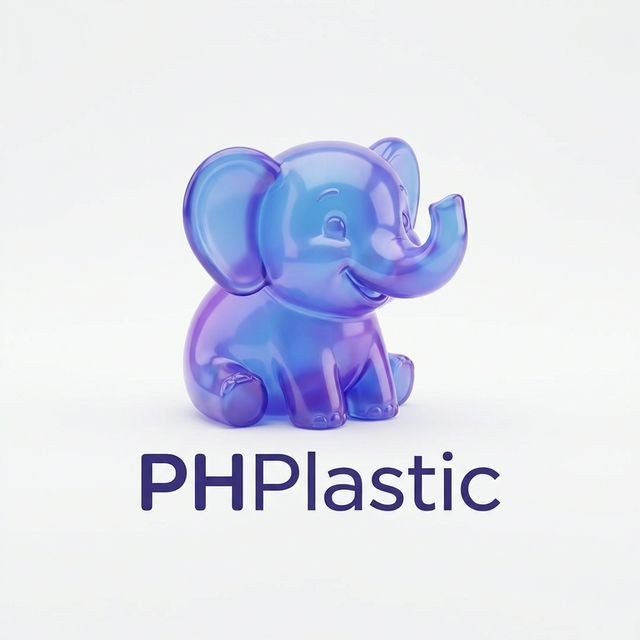

<p align="center">
  
</p>

# PHPlastic
> The **AI-Driven Modular Engine** (v0.7.0) – Build your Web App in Seconds

PHPlastic is a minimalist yet powerful PHP/SQLite framework designed to **write itself**. Featuring an integrated *AI Bootstrap Wizard* powered by LLMs (Groq / OpenRouter), PHPlastic allows you to translate a simple text prompt ("I want an E-commerce", "Create a To-Do list") directly into:
1. Interactive files and views (`HTML/Tailwind`).
2. **SQLite** Database tables (`DDL Auto-migrations`).
3. Isolated REST API Modules (`Dynamic Routing`).

No complicated configurations or heavy ORMs—just full native MVC control.

## 🚀 Installation

1. Clone this repository.
2. Ensure you have **PHP 8.2+** and the **PDO SQLite** extension enabled in your `php.ini`.
3. Start the built-in PHP development server pointing to the `public` folder:
   ```bash
   php -S localhost:8000 -t public
   ```
4. Open `http://localhost:8000` in your browser.

## 🔑 First Access (Super Admin)

On the first run, navigate to `/login`:
- **Email:** `admin@phplastic.local`
- **Password:** `password`

## 🧠 Using the AI Wizard

Once logged in, go to the dashboard and click on **"Bootstrap Wizard"**. Enter a detailed prompt of what you want to build. The AI will generate a preview of files and SQL queries.
1. Select the AI model from settings (`Settings > Sync models from Groq`).
2. To enable the AI, enter your **Groq** API Key in the `.env` file (copy `.env.example` if it doesn't exist and define `GROQ_API_KEY=your_key`).
3. In the Wizard page, type (example): *"Create an API module for Book management. I need a 'books' sqlite table and a REST Controller in app/Modules/Books/BooksController.php"*.
4. Click **Apply Patch**, and the framework will inject routes, controllers, and generate the SQLite database for you in real-time!

## 🧩 Dynamic Modules (v0.6)

Starting from version 0.6, PHPlastic supports route auto-discovery and Modules (Plugins). Place your controllers inside `app/Modules/{MyModule}/` and include a `routes.php` file. The framework will automatically load them at startup without touching the central routing file!

*Happy (AI-Assisted) Coding!*

